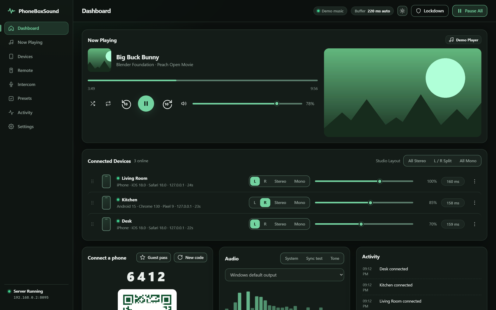
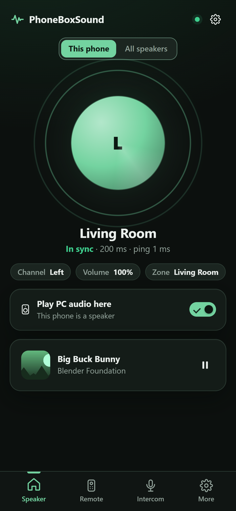
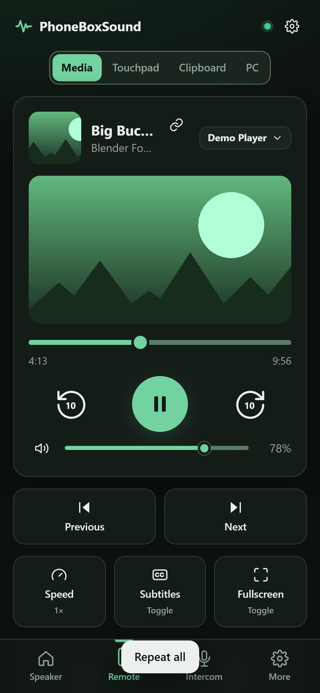
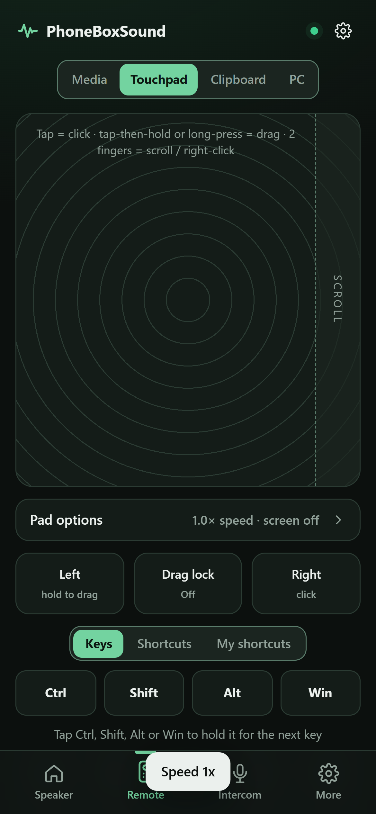
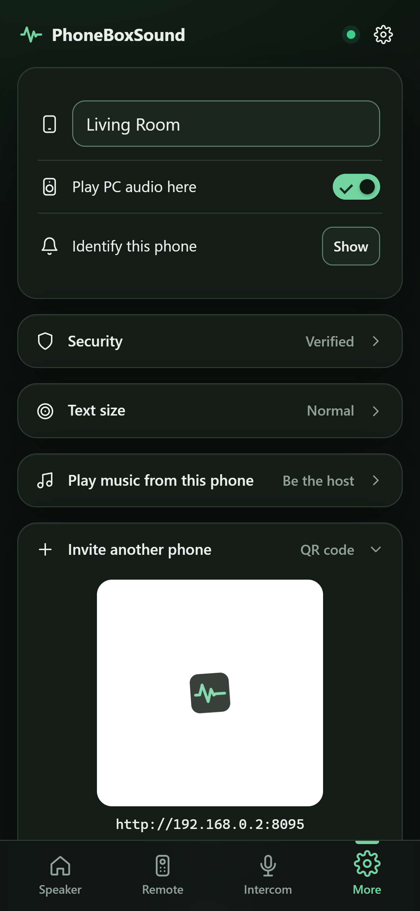
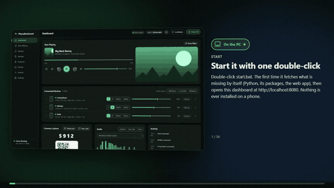
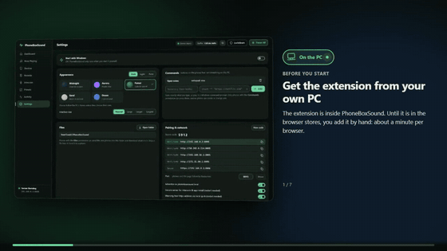
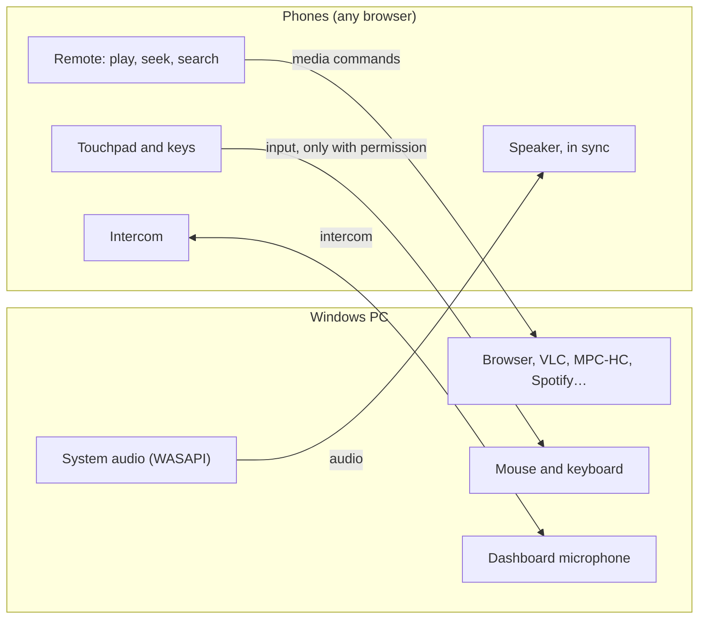

# PhoneBoxSound

**Your PC sound. Everywhere.** Turn the phones you already own into synchronised wireless speakers,
a media remote and an intercom for your Windows PC. Phones just open a web page: nothing to install.

No cloud · no account · no app install · local network only · free for non-commercial use · by Pritom Barua

[](https://github.com/pritombarua1/PhoneBoxSound/actions/workflows/tests.yml)
[](https://github.com/pritombarua1/PhoneBoxSound/releases/latest)
[](NOTICE.md)



<p align="center">
  
  
  
  
</p>

**Website:** [https://pritombarua1.github.io/PhoneBoxSound/](https://pritombarua1.github.io/PhoneBoxSound/): the guide, the [guided tour](https://pritombarua1.github.io/PhoneBoxSound/tour.html) you can step
through, and **[how it works and how it measures up](https://pritombarua1.github.io/PhoneBoxSound/results.html)**: diagrams, the results of the
automatic tests on the current version, and how to run the same checks yourself.

## Videos

| Guided tour: every screen and setting | Adding the browser extension by hand |
|---|---|
| [](docs/media/tour.mp4) | [](docs/media/extension-install.mp4) |
| **[Watch the full tour (19 min)](docs/media/tour.mp4)**: spoken voice, numbered steps, and a marker for where each thing happens (on the PC, on the phone, in the browser) | **[Watch it (3 min)](docs/media/extension-install.mp4)**: Chrome, Edge, Brave, Opera, Vivaldi and Firefox, step by step |

Click a picture or link, then press play on GitHub's player. Both videos are also attached to each
[release](https://github.com/pritombarua1/PhoneBoxSound/releases/latest) to download, along with the
**[illustrated guide (PDF)](docs/PhoneBoxSound-Guide.pdf)**. Short demo clips: [`docs/media`](docs/media).
To step through at your own pace, download the repository and open `docs/tour.html` or `docs/index.html`
in a browser.

## Quick start

You need a Windows 10 or 11 PC and phones on the same Wi-Fi. Nothing is installed on the phones.

**Easiest: the ready-made download.** Open the
[Releases page](https://github.com/pritombarua1/PhoneBoxSound/releases/latest), download
`PhoneBoxSound-win64.zip`, unzip it anywhere and double-click `PhoneBoxSound.exe`. Everything it needs is
inside; nothing else is downloaded or installed.

**From the source code: double-click `start.bat`.** It sets up whatever is missing by itself, once:

| If this is missing | `start.bat` gets it from | Notes |
|---|---|---|
| Python 3.10 or newer | winget, or python.org directly when winget is not there | installed for your user only; the python.org file is checked to be signed by the Python Software Foundation |
| Python packages | pypi.org, as listed in `requirements.txt` | for your user only; again only when that list changes |
| The built web app | built with a portable Node.js from nodejs.org, kept in `tools\node` | checked against nodejs.org's published checksum; nothing is installed in Windows |

Then it starts PhoneBoxSound and opens the dashboard. `start.bat --check` only reports what is there and
what is missing, and changes nothing.

### The first start

Before anything is downloaded, `start.bat` shows one screen that says what it will download, from where,
under which licence, and that with winget it accepts winget's source agreement and the package licence on
your behalf (`--accept-source-agreements --accept-package-agreements`). It also says what the program can
do to your PC and who is responsible for what (see [Disclaimer](#disclaimer)). Nothing happens until you
type **Y**. The dashboard shows the same terms once more the first time it opens, unless you already
agreed in `start.bat`; the ready-made download shows them there.

After that: scan the QR code on the dashboard with each phone, approve the phone on the **Devices** page,
and give it what it should be allowed to do on the **Remote** page. To have it start with Windows, switch
that on at the top of **Settings**. The [guided tour video](docs/media/tour.mp4) shows every step.

**By hand, from source:** Windows 10/11, [Python 3.10+](https://www.python.org/), [Node.js 20+](https://nodejs.org/).

```bash
npm install        # web dependencies (once)
npm run setup      # Python dependencies (once)
npm start          # build the web app and run the server
```

The dashboard is at `http://localhost:8080/dashboard` (each page has its own address: `/devices`, `/settings`…). On each phone, scan the QR code, enter the 4-digit
code and tap **Join**. Paired phones reconnect by themselves, and any paired phone can invite the next
one from its **More** tab.

| Command | What it does |
|---|---|
| `npm run dev` | Server + live-reloading UI at `http://localhost:5173/dashboard` |
| `npm run build` | Type-check and build the web app into `web/dist` |
| `npm start` | Build, then run the server on port 8080 |
| `npm run serve` | Run the server with the existing build |
| `npm test` | Python unit tests |
| `npm run package` | Standalone Windows build: `release/PhoneBoxSound-win64.zip` (needs `pip install -r requirements-dev.txt`) |
| `npm run docs` | Regenerate screenshots, videos and the PDF. Also the end-to-end test (150+ checks with real multi-touch on the touchpad) |
| `python scripts/loadtest.py` | Load test: 1, 10, 30 and 50 simulated phones; loss, jitter and time to spare per phone |
| `node scripts/screencheck.mjs` | Checks that screen view never disturbs the sound (`--video` for the video stream, `--busy`, `--mbps 4`, `--cpu 2` for harsher conditions) |
| `npm run docs:videos` | Re-record the guided tour and the extension video from the current screenshots |

Server options: `python -m phoneboxsound --help` (`--port`, `--no-https`, `--no-tray`, `--demo`, `--test`, `--config`…).
Environment: `PHONEBOXSOUND_PORT`, `PHONEBOXSOUND_HTTPS_PORT`, `PHONEBOXSOUND_BUFFER_MS`, `PHONEBOXSOUND_API_TOKEN`, `PHONEBOXSOUND_CONFIG`.

## Engineering highlights

- **Sample-exact sync over Wi-Fi.** The PC's sound is captured with WASAPI loopback in 10 ms blocks, each
  stamped with the PC's clock. Every phone measures its own offset to that clock (fast round trips only,
  thrown away as soon as fresh ones disagree) and schedules each block for an exact sample on its audio
  clock. Drift is absorbed by a ±0.4% playback-rate nudge, never by a jump.
- **The sound always goes first.** Screen view travels on its own connection, in small paced slices that use
  at most what the sound leaves free. The phone says "strain" the moment sound arrives with too little time
  to spare, and pictures pause and shrink at once. Measured below.
- **Security a phone cannot talk its way past.** Each phone makes its own ECDSA P-256 key in the browser
  (never leaves it) and signs a challenge to get in; new phones wait for approval; every PC-reaching
  ability is off until switched on, checked on the PC for every message; lockdown, DNS-rebinding and
  origin checks, strict CSP. Settings are stored encrypted (AES-256-GCM, scrypt) once a password is set.
- **A record you can replay.** Two days per phone, to the millisecond: every request, what the PC did with
  it, and a screen replay rebuilt from the phone's own page snapshots.
- **Built and checked by machines.** Unit tests, a 158-check end-to-end run with real multi-touch, a load
  test and the screen-view check run on GitHub's Windows machines for every change; releases are built
  there from source with exact, checksummed dependencies.

### Measured (snapshot)

The latest numbers, with diagrams of the sync, the screen view and the security model, are on the
[results page](https://pritombarua1.github.io/PhoneBoxSound/results.html), rebuilt by GitHub's machines after every change. At the time of writing:


**Many phones** (`python scripts/loadtest.py`: simulated phones on the same PC, 20 s each):

| Phones | Blocks lost | Arrival unevenness (p99) | Time to spare before playing (worst) | Clock round trip |
|---|---|---|---|---|
| 1 | 0 % | 0.55 ms | 138 ms | 0.3 ms |
| 10 | 0 % | 0.62 ms | 132 ms | 0.4 ms |
| 30 | 0 % | 0.82 ms | 117 ms | 0.6 ms |
| 50 | 0 % | 0.95 ms | 88 ms | 0.7 ms |

**Screen view against the sound** (`node scripts/screencheck.mjs`: a phone with a 2× slower processor
watching a detailed, fast-changing screen through a simulated Wi-Fi link, 15 s, counted from the first
second):

| Link | Sound late | Playback jumps | Sync buffer | Pictures per second |
|---|---|---|---|---|
| 3 Mbit/s (weak) | 0 | 0 | unchanged | 3.5 |
| 6 Mbit/s | 0 | 0 | unchanged | 5.5 |
| 20 Mbit/s | 0 | 0 | unchanged | 5.6 |
| 50 Mbit/s (simple screen) | 0 | 0 | unchanged | 8.3 |

As **video** (with the helper), same phone and links:

| Link | Sound late | Playback jumps | Sync buffer | Frames per second |
|---|---|---|---|---|
| 3 Mbit/s (weak) | 0 | 0 | unchanged | 14.5 |
| 4 Mbit/s | 0 | 0 | unchanged | 22.9 |
| 6 Mbit/s | 0 | 0 | unchanged | 24.7 |
| 20 Mbit/s | 0 | 0 | unchanged | 24.6 |

On this PC's real 4K screen with real music playing (`npm run check:real`): about 22 frames a second,
0 late sound blocks.

These run on one PC, so they measure PhoneBoxSound itself; a real home network adds its own delays, which
the sync buffer is there to absorb.

## What it does

**Speakers**
- Captures everything the PC plays (before the PC volume, so the PC itself can be muted).
- Every phone plays each 10 ms block at the same agreed moment: *capture time + sync buffer*, scheduled on
  the phone's audio clock. Drift is absorbed by a speed nudge of at most 0.4%: no clicks, no restarts.
- The buffer adapts to your Wi-Fi: raised instantly when a phone struggles, lowered gently when it's calm.
- Per phone: left / right / stereo / mono, volume, fine offset, sound profile; zones (rooms) with their own volume.
- **Auto-calibrate:** each phone chirps while the PC microphone listens; offsets and loudness are then matched.
- **Sync nudge** on the phone itself, with a click test, to line two phones up by ear.
- **A phone can host the music:** pick audio files on a phone and every phone plays them in sync.
- **Speaker roles:** left, right, stereo, mono, bass only (a tablet as the subwoofer), rear (ambience).
  A **data saver** per phone halves the Wi-Fi use.
- **All speakers from one phone:** a phone with the permission can set every phone's volume, channel and
  timing, the layout, master volume and the click test. No walking to the PC.

**Remote**
- Shows what's playing and follows you: the player you started, resumed or changed last wins, preferring
  the one actually making sound. Pin a player from the phone or the dashboard.
- Works with browsers, Spotify and Windows apps (media sessions), **MPC-HC/MPC-BE (K-Lite)** and **PotPlayer**
  with no setup, **VLC** after one click, and **mpv**. Players without cover art show the live video frame.
- Play/pause, ±10/±30 s, drag-to-skim timeline, speed (slower / normal / faster / presets), subtitles,
  fullscreen, volume. The phone's lock screen controls work too.
- **Shuffle and repeat** (off / all songs / one song) for players that support it: Spotify and other
  Windows media apps, VLC, mpv.
- **Touchpad:** tap, tap-then-hold to drag, two-finger scroll and right-click, a scroll strip, drag lock,
  pointer speed scaled to the PC's resolution, and typing.
- **Keyboard:** hold Ctrl / Shift / Alt / Win and press any key (Ctrl+S, Alt+F4, Win+Shift+S…), F1–F12,
  ready-made shortcuts for editing, browsers and Windows, and your own saved shortcuts.
- **See better:** a magnifier shows the area around the PC pointer on the phone, enlarged 2–8× and sharp;
  buttons for Windows' own Magnifier and for text size in the active window; a text-size setting for the app.
- **Files:** send photos and files from the phone into a shared folder on the PC, and download what's in it.
- **Commands:** buttons for commands you define on the PC ("Open Netflix", a script, a shortcut).
- **Power:** lock, sleep, restart or shut down the PC. Each asks first; sleep, restart and shut down then
  count down (cancellable from the phone or the dashboard).
- **Screen view:** the whole screen or the active window, live inside the touchpad, with the PC's cursor.
- **Clipboard, both ways:** read what you copied on the PC, send text or a picture to the PC clipboard,
  optionally paste it straight into the active window. A "Live" switch pushes PC copies to the phone.

**Intercom**
- Hold (or tap) to talk from any phone or the dashboard to everyone, a room or one phone. Music ducks.
- Phones need the secure (https) page for the microphone; the app switches with one tap.

**Safety**
- The room code issues each phone its own token (stored hashed). Five wrong codes lock an address out for a minute.
- **Approval:** the code (or QR) only gets a new phone into a waiting room. Until you press Approve on the
  Devices page it receives nothing: no sound, no media info, no controls. A phone with the *Approve*
  permission can approve or deny for you. The code can never take over a phone that is already paired.
- **Lockdown:** one button in the top bar. Phones keep playing; none can control the PC, nobody new can
  join, the API only answers this PC.
- **Dashboard password and encrypted storage:** see [Password and storage](#password-and-storage).
- **Every permission is checked on the server**, for every message. A phone that sends hand-made messages
  for things it isn't allowed gets nothing, is logged, and is disconnected after repeated attempts.
- **Browser protections:** strict Content-Security-Policy (no injected or inline scripts, no foreign
  connections), no framing, no MIME sniffing, no referrers; cross-site and DNS-rebinding requests are
  refused. Phones cannot download the dashboard's code at all.
- **Past devices:** a phone that presses "Forget this PC" stays on record (name, system, last address)
  without any way back in; search the Devices page by name, address, system, id or zone.
- **Each phone has its own key.** On the secure page the phone's browser creates an ECDSA P-256 key pair
  whose private half cannot be exported, and registers the public half. Every later connection must sign a
  fresh random challenge, so copying a phone's saved id and token to another device gets "security check
  failed".
- **Strict security (on by default):** a phone that has not proved its key (for example one on the plain
  http link) can still be a speaker, media remote and intercom, but the permissions that reach into the PC
  stay locked. A phone that already holds such permissions when it first presents a key shows a 4-digit
  number; press **Verify** on the Devices page when it matches. **Reset key** makes a phone enrol again.
- Roles per phone: speaker, media remote, intercom, and eight that reach into the PC itself and are off
  until you enable them: keyboard & mouse, clipboard, screen view, power, manage all speakers, files,
  commands, host music.
- **Block a phone:** it is disconnected and refused from then on, even with the room code.
- The dashboard and API answer only this PC or the API token; cross-site requests are refused.

## Permissions

One switch per phone and per ability, on the dashboard's **Remote** page (and on each phone's row under
**Devices**). Everything that reaches into the PC is off until you switch it on.

| Permission | At first | The phone can |
|---|---|---|
| **Speaker** | on | Plays the PC's sound on this phone, in sync with the others. |
| **Media remote** | on | Play, pause, skip, seek and volume of what is playing; see the queue; share its link. |
| **Intercom** | on | Talk to the other phones and the PC, and hear announcements. |
| **Search and play** | on | Search YouTube, Spotify and Apple Music and start a result on the PC. |
| **Keyboard & mouse** | **off** | Move the PC's pointer, click, scroll and type: full control of whatever is on screen. |
| **Clipboard** | **off** | Read what you copied on the PC, and put text or pictures on the PC's clipboard. |
| **Screen view** | **off** | See the PC's screen (or the active window) live on the phone. |
| **Power** | **off** | Lock, sleep, restart or shut down the PC, each after a confirmation and a countdown. |
| **Manage speakers** | **off** | Change every phone's volume, channel and timing, pause all, start the bedtime timer. |
| **Files** | **off** | Send files to the PC's share folder and download what is in it. Nothing outside that folder. |
| **PC commands** | **off** | Press the command buttons you made in Settings. A phone can never create or change one. |
| **Host music** | **off** | Play audio files from this phone on every phone, in place of the PC's sound. |
| **Approve phones** | **off** | Let a waiting phone in, or turn it away, without going to the PC. |
| **Shake to lock down** | **off** | Three firm shakes of this phone put the PC into lockdown. |

The ones that start off are also withheld from a phone that has not proved its own key while **strict
security** is on, and from every phone during **lockdown**.

## Settings

| Setting | What it does |
|---|---|
| **Start with Windows** | Starts quietly when you sign in, with a tray icon. Off: it only runs when you start it. |
| **Appearance** | Dark / light / system, five themes, interface size. Phones follow unless they choose their own. |
| **Commands** | Buttons that run a program or script on this PC, for phones with the PC commands permission. |
| **Files** | The one folder phones with the Files permission can send to and download from. |
| **Room code, addresses, port** | New code any time. Changing the port moves connected phones along. |
| **Advertise as phoneboxsound.local** | Lets phones use a name instead of a number address. |
| **Secure server / warning-free https** | https on the same port. The warning-free address removes the browser warning; it needs internet. |
| **Approve new phones** | The code alone is not enough: a new phone waits until you approve it. |
| **Lockdown** | No phone controls the PC, no new phones, no remote API. Phones keep playing. |
| **Strict security** | PC controls only for phones that proved their own key on the secure address. |
| **PC speakers in step** | Delays the PC's own speakers or headphones to match the phones. |
| **Lighter stream on poor Wi-Fi** | A struggling phone gets half the data until its connection recovers, and is told to come closer. |
| **Auto buffer, minimum, maximum** | How far behind the PC the phones play. Auto adapts it to your Wi-Fi within the limits. |
| **Lip-sync** | Shifts the player's audio so phones match the picture (VLC, MPC-HC, mpv). |
| **Player integrations** | One-click VLC setup, mpv pipe, MPC full control, the browser extension. |
| **Search keys, Spotify account** | Optional YouTube key; your Spotify app's ID to link your account. |
| **Password & encrypted storage** | Dashboard password; settings encrypted with it; ask at every server start or not. |
| **API & automation** | Token, example commands, webhooks. |
| **Diagnostics** | Health at a glance and an export with no secrets in it. |
| **Activity record (Activity page)** | The two-day record of what each phone did. Switch it off entirely, or erase it. |
| **On each phone: More** | Theme, text size, timing, shake to lock down. Pad options: pointer speed, open the keyboard by itself. |

## How it works



1. **Shared clock.** Phones ping the PC and keep only recent, fast round trips. If fresh measurements
   disagree (the browser was asleep), the old ones are dropped immediately.
2. **Scheduled playback.** Blocks are queued for an exact sample on the phone's audio clock.
3. **Drift correction.** Small errors are absorbed by a ±0.4% playback-rate nudge.
4. **Adaptive buffer.** Phones report the buffer they need; the PC uses the largest.

## Architecture

```
phoneboxsound/          Python server
  app.py                HTTP/HTTPS, WebSockets, REST API
  hub.py                devices, pairing, approval, permissions, routing, adaptive buffer, intercom
  identity.py, vault.py per-phone keys; password-protected encrypted storage
  journal.py            two-day activity record per phone (compact block format)
  system.py, branding.py, autostart.py   device description; themed icons and QR; start with Windows
  audio.py              WASAPI loopback capture, timestamps, packet format
  media.py, players.py  what is playing, and how to control it
  snap.py               captures the current video frame for artwork
  desktop.py            clipboard and screen view (plus the in-memory demo versions)
  power.py              lock, sleep, restart, shut down
  inputctl.py           keyboard and mouse injection
  calibrate.py          chirp detection for auto-calibration
web/                    React + TypeScript + Vite
  src/player/           phone app; engine.ts does sync and playback outside React
  src/control/          dashboard; each page is a lazy-loaded chunk
  src/lib/              clock sync, wire format, intercom audio, UI kit, store
scripts/docs.mjs        screenshots, videos, PDF and end-to-end checks (headless Chrome)
scripts/dev.mjs         npm run dev
scripts/package.py      npm run package (PyInstaller)
tests/                  Python unit tests
```

Design notes: the phone's audio path never touches React (100 packets a second must not wait for a render);
meters, the spectrum and timelines write to the DOM directly; builds are content-hashed so phones can cache
them forever and still always load the current version.

## Activity record and replay

The **Activity** page keeps a record of each phone for 48 hours, stamped to the millisecond with the PC's clock.

- **Every request and its result.** Each message a phone sends carries the phone's own running number, and
  the record stores what the PC did with it: carried out, or refused and why. Each message the PC sends
  carries the PC's number, and the phone reports the last one it received. The page shows, per line,
  `✓ done` / `✗ refused` / `✓ received`, and a summary: how many requests, how many carried out, whether
  anything was lost in between.
- **The phone's screen.** The phone sends the part of its page that changed since the previous picture
  (taps within 140 ms, otherwise every few seconds). **Replay** rebuilds those pictures in order, with
  the finger's position, so you see what the phone showed and what was typed (passwords and the room code
  masked), not a re-enactment. 1× to 64×, step, scrub to any moment. No script from a recording can run.
- **Compact on purpose.** One block per second per phone, compressed with a dictionary of the phrases every
  line shares, then encrypted when a password is set. Pointer movements are kept individually inside one
  line per burst; settings are stored as what changed; "now playing" when it changes; sound, screen
  pictures and clock pings as totals per 10 s. A very busy test session (510 lines, 211 screen pictures)
  takes 64 kB.
- Not recorded: the sound itself, the live PC-screen view, level meters. Tokens, the room code and
  signatures are never written.
- `GET /api/journal`, `GET /api/journal/{device_id}?from=<ms>&to=<ms>&limit=5000`,
  `POST /api/journal/{device_id}/clear`, `POST /api/journal/clear`. Format: see `phoneboxsound/journal.py`.

## System, port, start-up, branding

- **System per phone:** what each device reports to be ("iPhone · iOS 18.5 · Safari") is kept with its record,
  with your own label beside it. If a known phone suddenly reports a different kind of system, its PC-control
  permissions are held back until you confirm the change on the Devices page. Browsers hide detail (Android
  model, Linux distribution, Windows 10 vs 11), so it is a description, not proof; identity is the key.
- **Port:** Settings → Pairing & network → Port → Move. The server starts answering on the new port, every
  phone and the dashboard are sent there with a one-time pass (they stay the same verified device), and the
  old port is released five seconds later.
- **Start with Windows:** a switch in the same card (current user's Run key; nothing else is installed).
  Starting a second copy shows the running one instead of failing.
- **Themed mark:** the QR code (with the logo in the middle), the browser-tab icon, the home-screen icon and
  the install information follow the theme. An icon already added to a phone's home screen keeps the picture it
  was added with: phones only read it at that moment.

## Typing on the PC

Tap a text box on the PC with the touchpad and the phone's keyboard comes up by itself; each key goes to the
PC as you type it (Backspace, Enter, Tab and the arrow keys included), and the keyboard goes away again when
you click something that isn't a text box. The PC answers one question for this, through Windows'
accessibility interface: is the thing under the pointer (or holding the keyboard focus) a box you can type
in? It never reads what is in the box. Switch it off under the touchpad's Pad options, or open the keyboard
by hand there.

An iPhone only raises its keyboard for a touch, so when it could not be opened inside your tap the bar under
the touchpad says **Tap here to type on the PC**: the whole bar is a text field, and one tap on it brings the
keyboard up. In the type box under the keys, Enter starts a new line; **Send** (or Shift+Enter) types the
whole text on the PC, and the ⏎ button presses Enter there.

## Search and play

On the phone (Remote → Media → Search) or the dashboard (Now Playing): type once, get suggestions while
typing, then results with their pictures; tap one and it plays on the PC. Each phone needs the
**Search and play** permission.

| Service | Results | Needs |
|---|---|---|
| Apple Music | yes | nothing (Apple's public catalogue) |
| YouTube | yes | nothing if `yt-dlp` is installed (it is in requirements.txt), or a YouTube Data API key |
| Spotify | yes | the free client id + secret from developer.spotify.com (Settings → Search) |
| Netflix, Prime Video, Disney+, Twitch, SoundCloud | no: they don't share results | a button opens their own search on the PC |

A phone never sends an address: it sends words, receives result ids and pictures served by this PC, and can
ask to open an id. The PC only opens addresses it built itself on those services. With the browser extension
the result opens in the same tab each time. `GET /api/search?q=…`, `POST /api/search/open {"id":"…"}`.

## Spotify account: queue, exact repeat, likes

Settings → Search → **Connect Spotify** links your account (sign-in happens on Spotify's own page, with only
your app's public Client ID; add the Redirect URI shown there to the app on developer.spotify.com first).
While Spotify is what's playing you then get **Up next**: the real queue, repeat *this song / all / off*,
shuffle, tap a queued song to jump to it, and **Play next** on Spotify search results. The **+** next to
the song saves it to Liked Songs or to one of your own playlists, and the playlists button starts any
playlist. The remote's
Repeat and Shuffle buttons also go through Spotify itself, so "this song" means this song.
Spotify lets other apps add to the queue but not reorder or remove items, and changing playback needs
Premium. PhoneBoxSound follows Spotify's February 2026 addresses and falls back to the earlier ones.
`GET /api/queue`, `GET /api/playlists`, `POST /api/queue/{repeat|shuffle|like|unlike|skip|add|playlist_add|playlist_play}`.

## Share what's playing

The link button on the phone's player card, or **Share** on the dashboard's Now Playing page, shows the picture,
a public link, a copy button and a QR code for whatever is playing.

- **A browser tab** (with the extension): the page's own address, tidied. YouTube becomes a short `youtu.be`
  link, plus one that starts at the current moment.
- **Spotify, Apple Music and other apps:** Windows passes on the title and artist but no address, so the song
  is looked up by name on Spotify (if its keys are set), Apple Music and YouTube, and marked "found by title".
- **A file on the PC:** there is no public link, and none is made up.

Only real public addresses are handed out: https, a proper domain, never an address on your own network.
`GET /api/share`.

## The PC's own speakers, in step

Windows plays to the PC's speakers at once; phones play the same sound a moment later (the sync buffer), so
the PC is always ahead. Settings → Sync → **This PC's speakers in step with the phones** makes PhoneBoxSound
play a copy on the output you choose, delayed by exactly the buffer and held on the same clock as the
phones: the sound captured at time *t* leaves the speaker at *t* + buffer, the device's own delay included.
The capture device and the output device drift apart by a few samples a second; that is measured all the
time and corrected one sample at a time. On a real output here it stays within about 2 ms.

It needs two outputs, because a sound already on its way to a speaker can't be held back: Windows plays to
one (a spare output, or the free VB-CABLE virtual device), PhoneBoxSound plays the delayed copy to the one
you listen on. Bluetooth and USB headsets add their own delay; the fine offset covers that.

## Connection quality

- Every phone's link is rated (excellent / good / weak / poor) from what it measures itself: round trip of the
  clock pings, how unevenly sound arrives, how much arrives too late. Browsers may not read Wi-Fi signal
  strength or distance, but these are what distance and walls do to the sound.
- A phone whose link stays weak shows "move closer to your Wi-Fi router". Wi-Fi reaches a phone from the
  router, not from the PC, so that is where closer helps; when the phone is on the PC's own mobile hotspot
  the PC *is* the centre, and the notice says so.
- A phone whose link stays poor is moved to the lighter stream (half the data) and back by itself.
- The Devices page shows each phone's share and the total Wi-Fi load (1.5 Mbit/s per phone at full quality).
- **Screen view as video**, the way remote-desktop programs (Parsec, AnyDesk) do it: the screen is captured
  straight from the graphics card, encoded as H.264 by the PC's own video chip (NVIDIA, AMD or Intel; else
  Windows' encoder or OpenH264) and decoded by the phone's hardware, up to 30 frames a second. A still
  screen costs almost nothing. It needs a free helper, FFmpeg, offered as a one-time download in Settings →
  Screen view (80 MB, LGPL, run as a separate program). Without it, or on phones too old for video, the
  screen is sent as pictures.
- Either way the screen travels on its own connection, in small paced slices that use at most what the
  sound leaves free. When sound starts arriving with little time to spare, the phone says so and the screen
  pauses and gets lighter at once (video restarts at a lower bitrate); it sharpens again while the sound
  stays calm. A phone showing the screen never makes the PC raise everyone's sync buffer, and its
  connection is judged by late sound only, so the screen never triggers "come closer" or the lighter
  stream.

## Password and storage

The first time you open the dashboard it asks you to choose a password.

- The dashboard, its WebSocket and the whole API then need that password, even on the PC itself.
  Sessions live in memory: a restart or **Lock now** signs every browser out.
- `config.json` is replaced by `config.vault`, encrypted with AES-256-GCM. The password is never stored
  (only a key derived from it with scrypt unwraps the data key), so it cannot be displayed or recovered,
  only changed by entering it.
- A record kept outside the file (Windows registry) remembers which vault belongs here and how far it has
  advanced. If the file is edited, swapped for another one, rolled back to an older copy or deleted, the
  server refuses to start and says why.
- By default your Windows account can open the vault (DPAPI), so the server starts by itself after a
  reboot. Turn on **Ask for the password every time the server starts** and nothing on the disk can open
  it: the server shows a single unlock page, to this PC only, and no phone can connect until you type it.
- Starting over: `python -m phoneboxsound --reset-protection` asks for the password, then erases the vault.

What this does not do: it protects the data and the dashboard, not the machine. Someone logged in as you on
an unlocked PC can still delete the file and its registry record (losing every paired phone, gaining
nothing that was in it), or tamper with the program itself. Lock Windows when you walk away.

## API

From the PC itself, or with `Authorization: Bearer <token>` (Settings → API, which also builds ready-to-paste
`curl` commands).

| Method | Path | Body |
|---|---|---|
| GET | `/api/status`, `/api/devices`, `/api/media`, `/api/diagnostics` | |
| POST | `/api/media/{action}` | `toggle`, `play`, `pause`, `next`, `previous`, `stop`, `seek {"value":10}`, `seek_to`, `speed`, `volume`, `pc_volume`, `pc_mute`, `fullscreen`, `subtitles`, `target` |
| POST | `/api/devices/{device_id}` | `{"volume":0.8,"channel":"left","offset_ms":12,"zone":"Bedroom","perms":{"input":true}}` |
| POST | `/api/stream` | `{"streaming":false}`, `{"master":0.7}`, `{"latency_ms":200}` |
| GET | `/api/scenes` | list scenes |
| POST | `/api/scenes/{id}` | apply a scene |
| POST | `/api/keys` | `{"keys":["ctrl","s"]}` press a key combination on the PC |
| POST | `/api/text` | `{"text":"hello"}` type text into the active window |
| GET / POST | `/api/clipboard` | read the PC clipboard / `{"text":"…"}` set it |
| POST | `/api/power/{action}` | `lock`, `sleep`, `restart`, `shutdown`, `cancel` |
| POST | `/api/commands/{id}` | run one of your PC commands |
| POST | `/api/devices/{device_id}/block` | `{"blocked":true}` |
| GET | `/api/pending` | phones waiting for approval |
| POST | `/api/devices/{device_id}/approve` | `{"ok":true}` or `{"ok":false}` |
| POST | `/api/settings` | `{"lockdown":true}`, `{"approval":true}`, `{"strict":true}` |

Webhooks (Settings) receive `device_connected`, `device_disconnected`, `media_changed`, `intercom_started`,
`intercom_stopped`, `scene_applied`, `streaming`.

## Limits

- Phones play behind the PC by the sync buffer (typically 80–250 ms). VLC, mpv and MPC-HC (K-Lite) are
  shifted automatically so the picture matches. For a browser tab the sound can't be made earlier, so the
  [browser extension](extension/README.md) shows the picture later instead; that works for ordinary web
  video, not for copy-protected films (Netflix, Prime Video, Disney+).
- Spotify: other apps may add to its queue but not reorder or remove items, and changing playback needs
  Premium. Netflix, Prime Video and Disney+ don't share search results with other programs.
- The phone's keyboard can only be opened by a page during a touch, so it opens when you *tap* a text box
  with the touchpad, not when a text box appears by itself on the PC.
- Windows only for capture and player control. The web app and demo mode run anywhere.
- Bluetooth transport isn't possible from a browser; use Wi-Fi or the Windows mobile hotspot.
- Secure pages without a warning use a public wildcard certificate from [local-ip.sh](https://local-ip.sh)
  (`https://192-168-0-18.local-ip.sh:8080` points back at `192.168.0.18`). It needs internet for the name
  lookup and to fetch the certificate (cached for a week), and its private key is public by design, so it
  removes the browser warning rather than adding secrecy against someone already on your Wi-Fi. Turn it off
  in Settings to use only the self-signed certificate (`https://<ip>:8080`, one "Advanced → continue").
- http and https share one port: `http://…:8080` and `https://…:8080` both work.

## Roadmap

Done since the first roadmap: file transfer, your own PC commands, a presentation remote, a data-saver audio
mode, bass/rear speaker roles, a phone hosting the music, a screen magnifier, the browser extension (every
tab its own player, picture in step), search across services, the Spotify queue and playlists, the PC's own
speakers in step, the activity record with screen replay.

Still open, and why:

- **Compressed audio (Opus / FLAC)** for 20+ phones or weak Wi-Fi. Needs a native encoder on the PC and
  WebCodecs on the phones; today's data saver halves the data instead.
- **Spotify, YouTube and other apps as a phone-hosted source.** No browser may capture another app's sound.
  Use Spotify Connect to play on the PC, or host audio files from the phone.
- **Phone notifications on the PC**, and ringing a phone whose page is closed. Needs a native phone app.
- **The browser extension in the stores**, for a one-click install (files and listing text are ready in
  `extension/`). PotPlayer has no audio-delay command to drive.
- True multichannel (5.1) capture, an OBS remote, Linux/macOS capture, a signed installer.

## Disclaimer

PhoneBoxSound is free software provided **as is**, without warranty of any kind. The authors and
contributors are not liable for any damage, loss or other consequence of using it, of copies or changed
versions made by others, or of how anyone uses it. It can give phones control over the PC it runs on; use
it only on computers, networks and devices you own or are allowed to use. Using it, or any part of its code,
to harm, spy on, harass or get into other people's devices, accounts or data is forbidden, and the authors
take no part in and no responsibility for any such use. You are responsible for who you let connect and
what you allow them to do. PhoneBoxSound is not affiliated with Microsoft, Google, Spotify, Apple, Mozilla
or any other company or product it mentions. The full text is in [DISCLAIMER.md](DISCLAIMER.md), which
also lists everything `start.bat` may download and whose terms apply.

## Licence

Copyright (C) 2026 Pritom Barua. Source available under the **PolyForm Noncommercial License 1.0.0**
([LICENSE](LICENSE); plain-words summary in [NOTICE.md](NOTICE.md)):

- **Free** to use, study, change and share for **non-commercial** purposes: at home, for yourself, family
  and friends, and in schools, charities, public research and government organisations.
- **Commercial use needs a licence from the author**: selling it or anything containing its code, using it
  in a business or paid service, or including it in a product. See
  [NOTICE.md → Commercial licence](NOTICE.md#commercial-licence).
- Every copy, and every piece of the code, must keep the author's name and these terms. A changed version
  that is shared must use another name and logo and say it is based on PhoneBoxSound by Pritom Barua.

Versions up to 3.2.0 were published under the GNU GPL v3; copies of those stay under it.

**Releases** are built, tested and published automatically from this source code by GitHub Actions.
Privacy: [PRIVACY.md](PRIVACY.md) (nothing is collected).

**Citing it:** use the *Cite this repository* button on the right of the GitHub page
([CITATION.cff](CITATION.cff)).

Contributions welcome: see [CONTRIBUTING.md](CONTRIBUTING.md) and the [code of conduct](CODE_OF_CONDUCT.md).
